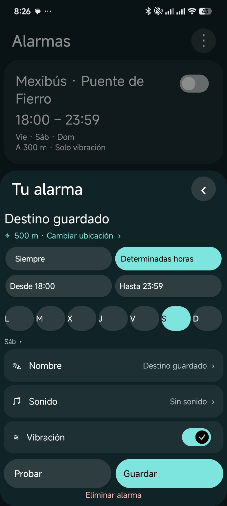
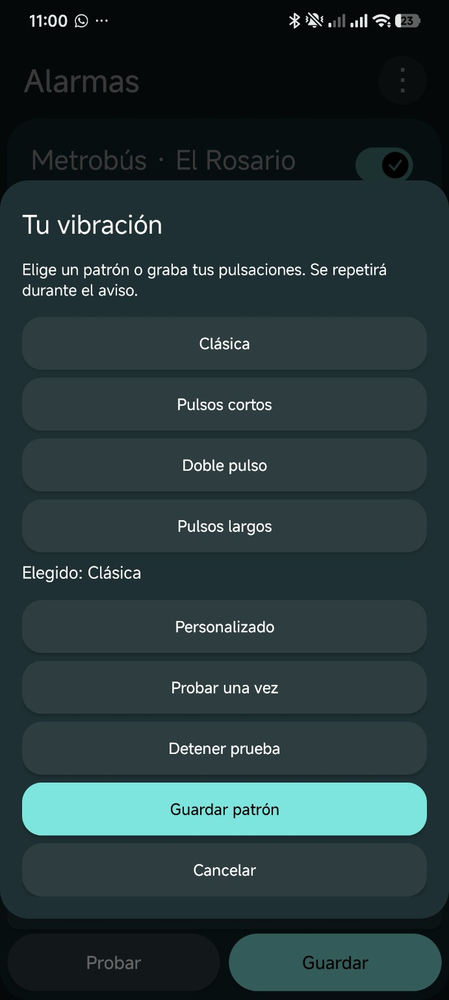

# Despierta

Alarma por ubicación para despertarte antes de tu parada de camión, Metrobús o Mexibús.

Creado por **Kusune**, con asistencia de **ChatGPT (Codex)**. Proyecto independiente. Versión **0.34 beta**.

## Así se ve Despierta

<table>
  <tr>
    <th>Horarios y alertas</th>
    <th>Patrones de vibración</th>
  </tr>
  <tr>
    <td></td>
    <td></td>
  </tr>
  <tr>
    <td>Elige cuándo vigilar tu llegada y cómo quieres que te avise.</td>
    <td>Escoge un patrón o graba tus propias pulsaciones.</td>
  </tr>
</table>

Capturas reales tomadas durante el desarrollo.

## Instalación y primer viaje

Descarga [Despierta 0.34 desde Releases](https://github.com/iRochiis/Despierta/releases/tag/v0.34), abre **Assets** y elige **Despierta_0.34.apk**. El artefacto de Actions está **sin firmar** y no se puede instalar directamente.

1. Instala la APK y concede ubicación precisa, notificaciones, ubicación todo el tiempo y, donde se solicite, Alarmas y recordatorios y acceso a alarmas en pantalla completa.
2. Pulsa **+**, elige destino y radio en mapa o coordenadas, configura días y Siempre / Determinadas horas, sonido y vibración. Guarda.
3. Abre Ajustes > **Listo para viajar**. Revisa permisos, señal, volumen y restricciones de batería del teléfono.
4. Prueba primero con el teléfono bloqueado y con tus audífonos. La app necesita recibir ubicaciones fiables; un túnel puede impedirlo.

## Funciones

- Alarmas guardadas, horarios y días; vigilancia de ubicación solo en franjas pendientes.
- Mapa OpenStreetMap/Leaflet, filtros de Metrobús y Mexibús, radio personalizado.
- Vibración repetida y patrones grabados; sonido multimedia o de alarma.
- Solo audífonos, con silencio y vibración al perder una salida privada.
- Aviso anticipado opcional y alerta final; confirmación si ya estás dentro del radio.
- Viaje puntual, reactivar para otro viaje e historial local borrable.
- Paletas, mascotas e importación de hojas de sprites.
- Diagnóstico copiable para reportar problemas, sin coordenadas ni nombres de alarmas.

## Compatibilidad

**Android 8.0 (API 26) o posterior**, GPS y Android System WebView operativo. No requiere Google Play Services, cuenta Google ni API key de Maps. Código Java/DEX sin bibliotecas nativas que limiten ARM/ARM64/x86; esto es compatibilidad de arquitectura declarada, no una prueba en todos los equipos. El mapa requiere internet; una alarma ya guardada evalúa el GPS sin descargar mapas.

Samsung, Motorola, Pixel, Xiaomi/Redmi, OnePlus, OPPO, Realme, Vivo y otras marcas son objetivos de prueba, **no certificaciones**. Se conserva evidencia del usuario de tres avisos satisfactorios en una versión anterior en Redmi; la 0.34 aún necesita prueba física. Ver [matriz y protocolo](docs/COMPATIBILIDAD.md).

## Compilar

El código histórico se recuperó del APK del propio proyecto y está en **Smali**. Los módulos nuevos están en Java. Este repositorio recompila esa base: **no es todavía un proyecto Gradle/Android Studio ni genera AAB**.

En Linux o WSL: JDK 17, Android SDK plataforma 35 + build-tools 35.0.0, Python 3, curl, zip y sha256sum.

```bash
export JAVA_HOME=/ruta/al/jdk-17
export ANDROID_HOME=/ruta/al/android-sdk
bash build.sh unsigned
# Para instalar una compilación local de prueba:
bash build.sh debug
```

El script descarga Apktool 2.12.1 y JSON-java 20240303 desde sus distribuciones oficiales con SHA-256 fijado, ejecuta 44 pruebas de lógica, 4 comprobaciones de regresión de los avisos GPS y controles del paquete, reconstruye y alinea la APK. La firma de prueba se guarda en `.private/`, ignorada por Git. Nunca es la firma pública del mantenedor. Ver [firma y publicación](docs/PUBLICACION.md).

## Reportar y colaborar

Abre un Issue usando la plantilla. Adjunta diagnóstico desde Ajustes > Listo para viajar > Compatibilidad y diagnóstico, junto con pasos y resultado. Evita compartir destinos, recorridos o capturas con datos personales. [Contribuciones](CONTRIBUTING.md), [privacidad](PRIVACY.md), [seguridad](SECURITY.md).

## Licencia y créditos

Código original bajo [MIT](LICENSE). Las bibliotecas, mapas, datos y personajes conservan sus condiciones: [THIRD_PARTY_NOTICES.md](THIRD_PARTY_NOTICES.md). La licencia del código no concede derechos sobre Hatsune Miku ni las mascotas de otros titulares. Revisa esa sección antes de distribuir esos recursos en una publicación pública.
